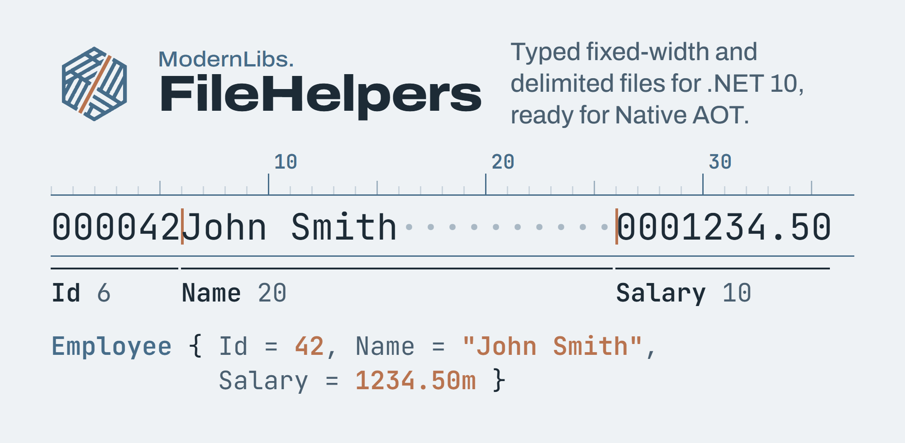

[](https://www.nuget.org/packages/ModernLibs.FileHelpers)
[](https://github.com/ModernLibs/FileHelpers/actions/workflows/ci.yml)
[](https://github.com/ModernLibs/FileHelpers/blob/main/LICENSE)

Typed reading and writing of fixed-length and delimited (CSV, TSV, pipe, ...) text files for
.NET 10, with the [FileHelpers](https://github.com/MarcosMeli/FileHelpers) 3.x API. You describe a
record layout with attributes; a source generator in the package writes the parsing and formatting
code at compile time. No runtime reflection, so it works with Native AOT and trimming.

- **The fastest fixed-width reader in our benchmarks:** more than twice as fast as FileHelpers 3.5.2
  and ahead of CsvHelper 34.
- **On par with the best CSV readers:** reading a 25-column file, ahead of Sep and CsvHelper 34 at
  every size we measured, level with Sylvan at 1M rows and behind it at 10K and 100K.
- **Drop-in for FileHelpers 3.x code:** the same attributes, engines, events and exceptions; most
  code migrates by changing the namespace.

## Benchmarks


Time and allocation for 100K records (fixed-width: 7 fields, class records; 25-column file with
dates), from the
[4.9.0 results](https://github.com/ModernLibs/FileHelpers/blob/main/docs/benchmarks/v4.9.0.md):

| Scenario | ModernLibs.FileHelpers 4.9.0 | FileHelpers 3.5.2 | Sep 0.17.1 | Sylvan.Data.Csv 1.4.4 | CsvHelper 34.0.0 |
|---|---:|---:|---:|---:|---:|
| Fixed-width read, 7 fields | **48 to 51 ms**, 39.7 MB | 111 ms, 59.5 MB | - | - | 54 ms, 40.9 MB |
| 25-column read | **155 ms**, 75.7 MB | 459 ms, 230.7 MB | 171 ms, 75.6 MB | 131 ms, 75.7 MB | 165 ms, 76.9 MB |
| Quoted-field read | **46 ms**, 22.8 MB | - | 29 ms, 20.5 MB | 38 ms, 22.8 MB | 28 ms, 21.7 MB |
| 25-column write | **69 to 70 ms**, 55.4 MB | - | 102 ms, 110.6 MB | - | 58 ms, 110.8 MB |

Measured on an Azure `Standard_D8as_v5` virtual machine (AMD EPYC 7763, Ubuntu 24.04, .NET 10.0.13)
with BenchmarkDotNet 0.15.8, default job. Where we are behind, the table says so: Sylvan reads the
25-column file faster at 10K and 100K rows (level at 1M), Sep, Sylvan and CsvHelper read quoted
fields faster, and CsvHelper writes faster. Sep and Sylvan do not read fixed-width files; we have not
benchmarked other fixed-width libraries such as RecordParser or FlatFiles.

A dash means the suite does not measure that library. ModernLibs.FileHelpers and FileHelpers 3.5.2
produce typed records through their attributes and converters; the other libraries are measured with
the row-to-object code written in each benchmark. Where a cell has a range, two suites measured the
same operation. [BENCHMARKS.md](https://github.com/ModernLibs/FileHelpers/blob/main/BENCHMARKS.md)
explains how to run the suite on your own hardware.

ModernLibs.FileHelpers is an independent reimplementation modelled on the API of FileHelpers 3.x by
Marcos Meli and contributors. FileHelpers 3.x is the reference for its behaviour. It is not the
original project: please report problems with this library
[here](https://github.com/ModernLibs/FileHelpers/issues), not upstream.

## Install

```bash
dotnet add package ModernLibs.FileHelpers
```

Requirements: .NET 10 or .NET 11 (`net10.0`, `net11.0`). Requires C# 11 or later (`MLFH026`): the .NET 10 SDK defaults to
C# 14, so this only matters if your project pins an older `<LangVersion>`. The package has no runtime
dependencies. The source generator is included as an analyzer;
there is nothing else to install.

## Quick start

### Delimited records

```csharp
using ModernLibs.FileHelpers;

[DelimitedRecord(",")]
[IgnoreFirst(1)]
public sealed class Customer
{
    public int Id;

    [FieldQuoted]
    public string Name = "";

    public decimal Balance;

    [FieldConverter(ConverterKind.Date, "yyyy-MM-dd")]
    public DateTime Joined;
}
```

```csharp
var engine = new FileHelperEngine<Customer>();

Customer[] customers = engine.ReadFile("customers.csv");   // the header line is kept in engine.HeaderText
foreach (Customer c in customers)
    Console.WriteLine($"{c.Id}: {c.Name} owes {c.Balance}");

engine.WriteFile("customers-copy.csv", customers);           // HeaderText is written back first
```

Fields are read in declaration order. Use `[FieldOrder(n)]` when you want the order to be explicit.

### Fixed-length records

```csharp
[FixedLengthRecord]
public sealed class Employee
{
    [FieldFixedLength(6)]
    [FieldAlign(AlignMode.Right, '0')]
    public int Id;

    [FieldFixedLength(20)]
    [FieldTrim(TrimMode.Right)]
    public string Name = "";

    [FieldFixedLength(10)]
    [FieldAlign(AlignMode.Right, '0')]
    public decimal Salary;
}
```

```csharp
var engine = new FileHelperEngine<Employee>();

Employee[] staff = engine.ReadString(
    "000042John Smith          0001234.50\r\n" +
    "000043Mary Jones          0000980.00\r\n");

string text = engine.WriteString(staff);   // writes the same layout back
```

`[FixedLengthRecord(FixedMode.AllowLessChars)]` and the other `FixedMode` values control how lines
that are shorter or longer than the layout are handled.

### Record structs without per-record allocations

Records can be `struct` or `record struct` types. A struct whose fields are all value types (numbers,
dates, `bool`, `Guid`, enums, ...) can be read through a callback or a streaming method without any
heap allocation per record:

```csharp
[DelimitedRecord(",")]
public record struct Trade
{
    public long Id;
    public decimal Price;
    public int Quantity;
}
```

```csharp
var engine = new FileHelperEngine<Trade>();

decimal notional = 0;
int count = engine.ReadFile("trades.csv", trade => notional += trade.Price * trade.Quantity);
```

The callback overloads of `ReadFile`, `ReadString` and `ReadSpan`, and the streaming `ReadSync`, do
not allocate a result array or a per-line string. A `string` field still allocates its string, and
the array-returning overloads still allocate the array. `ReadString` and `ReadSpan` also accept a
`SpanRecordCallback<T>` that receives each record by reference.

## Features

- **Delimited and fixed-length records** described with FileHelpers-style attributes: `[DelimitedRecord]`,
  `[FixedLengthRecord]`, `[FieldOrder]`, `[FieldFixedLength]`, `[FieldQuoted]`, `[FieldTrim]`,
  `[FieldAlign]`, `[FieldConverter]`, `[FieldNullValue]`, `[FieldOptional]`, `[FieldInNewLine]`,
  `[FieldHidden]`, `[FieldNotEmpty]`, `[IgnoreFirst]`, `[IgnoreLast]`, `[IgnoreEmptyLines]`,
  `[IgnoreCommentedLines]`, `[ConditionalRecord]` and more.
- **Record shapes**: classes, structs, `record` and `record struct` types, including positional records,
  types without a parameterless constructor (values are bound by constructor parameter name) and
  `required` members. `public`, `internal` and `protected internal` fields and properties are mapped;
  use `[FieldHidden]` to leave one out. `private` and `protected` members cannot be mapped, and the
  ones FileHelpers 3.x would read as columns are reported (`MLFH023`, `MLFH028`).
- **Field types**: `string`, `char`, `bool`, all integer types, `decimal`, `double`, `float`,
  `DateTime`, `DateOnly`, `TimeOnly`, `DateTimeOffset`, `TimeSpan`, `Guid`, enums and their nullable
  forms. Other types use a custom converter.
- **Converters**: built-in converters with FileHelpers 3.x parsing rules and culture-independent
  defaults, per-field culture (`[FieldConverter(..., CultureName = "de-DE")]`), 3.x-style
  `ConverterBase` custom converters, and span-based `ISpanConverter<T>` converters.
- **Engines**: `FileHelperEngine<T>` (read/write string, span, file, `TextReader`/`TextWriter`,
  append), `FileHelperAsyncEngine<T>` (record-by-record `BeginRead*`/`ReadNext` and
  `BeginWrite*`/`WriteNext`), `MultiRecordEngine` (several record types in one file) and
  `MasterDetailEngine<TMaster, TDetail>` (grouped master/detail lines).
- **Streaming**: `ReadSync` (`IEnumerable<T>`), `ReadAsync` (`IAsyncEnumerable<T>` with cancellation),
  callback reads, and async variants of the multi-record and master/detail engines.
- **Parallel reads**: `ParallelReadFile` / `ParallelReadString` extension methods split large inputs
  into chunks and keep sequential semantics (same records, errors and line numbers).
- **Events**: `BeforeReadRecord`, `AfterReadRecord`, `BeforeWriteRecord`, `AfterWriteRecord`, `Progress`,
  and `INotifyRead<T>` / `INotifyWrite<T>` on the record type.
- **Errors**: FileHelpers 3.x exception types and `ErrorMode` handling (see below).
- **Quoting as in FileHelpers 3.x**: per-field quote character, `QuoteMode` on read and write, and
  multiline quoted values allowed by default.
- **Compile-time diagnostics**: layout mistakes are reported as build errors and warnings
  (`MLFH001`-`MLFH029`), see the [diagnostics reference](https://github.com/ModernLibs/FileHelpers/blob/main/docs/diagnostics.md).
  Diagnostics come from an analyzer shipped in the generator assembly. `MLFH` warnings can be
  suppressed as usual; errors that block the descriptor cannot (`#pragma`, `.editorconfig`, `NoWarn`
  are ignored). If they are hidden with `[SuppressMessage]` or `RunAnalyzers=false`, using the record
  throws a `BadUsageException` that names the errors (see
  [suppressing diagnostics](https://github.com/ModernLibs/FileHelpers/blob/main/docs/diagnostics.md#suppressing-diagnostics)).

## Error handling

By default (`ErrorMode.ThrowException`) the first bad record stops the read with an exception that
carries the line number:

| Exception | Raised when |
|---|---|
| `ConvertException` | A field value cannot be converted (also `[FieldNotEmpty]` violations). Has `FieldName`, `FieldType`, `FieldStringValue`, `LineNumber`, `ColumnNumber`. |
| `NullValueNotFoundException` | A non-nullable value-type field is empty and has no `[FieldNullValue]`. |
| `BadUsageException` | The line does not match the layout (extra fields, wrong fixed width, unclosed quote, ...). |
| `FileHelpersException` | Base class of all of the above; also raised for lines with too few fields. |

```csharp
try
{
    engine.ReadFile("customers.csv");
}
catch (ConvertException ex)
{
    Console.WriteLine($"Line {ex.LineNumber}, field {ex.FieldName}: '{ex.FieldStringValue}' is not a {ex.FieldType.Name}");
}
```

With `ErrorMode.SaveAndContinue` bad records are skipped and collected; `ErrorMode.IgnoreAndContinue`
skips them silently:

```csharp
var engine = new FileHelperEngine<Customer> { ErrorMode = ErrorMode.SaveAndContinue };
Customer[] good = engine.ReadFile("customers.csv");

foreach (ErrorInfo error in engine.ErrorManager.Errors)
    Console.WriteLine($"Line {error.LineNumber}, field {error.FieldName}: {error.ExceptionInfo?.Message}");
```

## Streaming large files

```csharp
await foreach (Customer c in engine.ReadAsync("big.csv", cancellationToken))
{
    // one record at a time
}

using var reader = new FileHelperAsyncEngine<Customer>();
reader.BeginReadFile("big.csv");
while (reader.ReadNext() is { } customer)
{
    // FileHelpers 3.x-style pull loop
}
```

See [Opt-in features](https://github.com/ModernLibs/FileHelpers/blob/main/docs/OPT-IN-FEATURES.md) for
callbacks, record recycling and parallel reads.

## Native AOT and trimming

All parsing and formatting code is generated at compile time. The library uses no reflection,
`Expression` compilation or `DynamicMethod`, and is built with `IsAotCompatible` and `IsTrimmable`
enabled, so the trim and AOT analyzers check it on every build. Applications that use it can publish
with `PublishAot=true`.

## Why it is fast

The read path works on `ReadOnlySpan<char>`: lines and fields are sliced, not copied, and numeric,
date and other value-type fields are parsed straight from the span. `ReadFile` parses records as it
reads the file instead of loading it into one string, buffers are pooled, and the quote scan uses
vector search. Struct records with value-type fields are read without per-record allocations (see
above), and this is checked by the test suite. Results depend on hardware and record shape; run the
[benchmark suite](https://github.com/ModernLibs/FileHelpers/blob/main/BENCHMARKS.md) on a machine
like your production one.

## Migrating from FileHelpers 3.x

The API follows FileHelpers 3.x: the same attribute names, engine classes, events and exception types.
Most code migrates by changing the namespace:

```diff
- using FileHelpers;
+ using ModernLibs.FileHelpers;
```

Some things are different. Runtime-reflection features (`ClassBuilder`, non-generic engines,
`DelimitedFileEngine` options) are not available, a few signatures changed, and some defaults differ
(UTF-8 encoding). The
[migration guide](https://github.com/ModernLibs/FileHelpers/blob/main/docs/MIGRATION.md) lists every
difference we know of.

## Versioning

4.x is a ground-up modern reimplementation that follows FileHelpers 3.x, so its major version
continues after 3.x. Versions 4.0.0 to 4.7.0 were development milestones, published only as source
releases on GitHub. **4.8.0 is the first release on NuGet.** From 4.8.0 on, the package follows
[Semantic Versioning](https://semver.org/). See the
[changelog](https://github.com/ModernLibs/FileHelpers/blob/main/CHANGELOG.md).

## Documentation

- [Migration guide](https://github.com/ModernLibs/FileHelpers/blob/main/docs/MIGRATION.md) - every difference from FileHelpers 3.x
- [Diagnostics reference](https://github.com/ModernLibs/FileHelpers/blob/main/docs/diagnostics.md) - `MLFH001`-`MLFH029`
- [Opt-in features](https://github.com/ModernLibs/FileHelpers/blob/main/docs/OPT-IN-FEATURES.md) - callbacks, streaming, recycling, parallel reads
- [Gap analysis](https://github.com/ModernLibs/FileHelpers/blob/main/docs/GAP-ANALYSIS.md) - FileHelpers 3.x features that are not included, and why
- [Benchmarks](https://github.com/ModernLibs/FileHelpers/blob/main/BENCHMARKS.md)
- [Changelog](https://github.com/ModernLibs/FileHelpers/blob/main/CHANGELOG.md)
- [Samples](https://github.com/ModernLibs/FileHelpers/tree/main/samples)

## Contributing

Issues and pull requests are welcome. See
[CONTRIBUTING.md](https://github.com/ModernLibs/FileHelpers/blob/main/CONTRIBUTING.md) for how to
build, test and submit changes.

## License and credits

MIT, see [LICENSE](https://github.com/ModernLibs/FileHelpers/blob/main/LICENSE).

The API and behaviour are modelled on [FileHelpers](https://github.com/MarcosMeli/FileHelpers) by
Marcos Meli and contributors (also MIT licensed). Thank you to everyone who built and maintained it.
