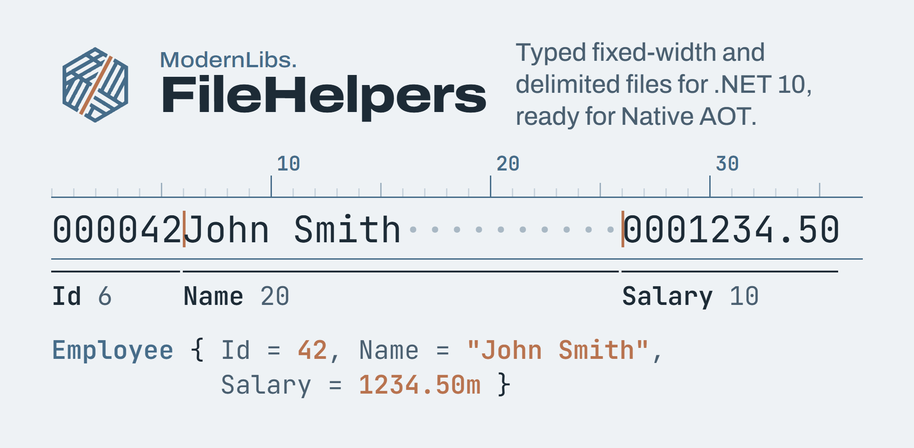

[](https://www.nuget.org/packages/ModernLibs.FileHelpers)
[](https://github.com/ModernLibs/FileHelpers/actions/workflows/ci.yml)
[](https://github.com/ModernLibs/FileHelpers/blob/main/LICENSE)

Typed reading and writing of fixed-length and delimited (CSV, TSV, pipe, ...) text files for
.NET 10 and .NET 11, with the [FileHelpers](https://github.com/MarcosMeli/FileHelpers) 3.x API. You
describe a record layout with attributes; a source generator in the package writes the parsing and
formatting code at compile time. No runtime reflection, so it works with Native AOT and trimming.

- **The fastest fixed-width reader in our benchmarks:** about twice as fast as FileHelpers 3.5.2
  reading into objects (2.4 times on our AMD test machine, 1.9 on the Intel one) and ahead of
  RecordParser and FlatFiles.
- **On par with the best CSV readers:** reading a 25-column file, ahead of Sep, CsvHelper 34,
  FlameCsv and RecordParser; level with Sylvan on our AMD test machine and behind it on the Intel
  one (about 20 % on .NET 10, about 6 % on .NET 11).
- **Drop-in for FileHelpers 3.x code:** the same attributes, engines, events and exceptions; most
  code migrates by changing the namespace.

## Benchmarks

Time and allocation for 100K records read into objects or written to a string (fixed-width: 7
fields, class records; 25-column file with dates), from the
[4.10.0 results](https://github.com/ModernLibs/FileHelpers/blob/main/docs/benchmarks/v4.10.0.md)
(library comparison, round `r3cmp-2026-11-19`; quoted fields, round `r3q-2026-11-20`). Times are
.NET 10 / .NET 11; the .NET 11 times are the package's `net11.0` asset, which is compiled with
runtime async on:

| Scenario | ModernLibs.FileHelpers 4.10.0 | FileHelpers 3.5.2 | Sep 0.17.1 | Sylvan.Data.Csv 1.4.4 | CsvHelper 34.0.0 | RecordParser 2.3.0 |
|---|---:|---:|---:|---:|---:|---:|
| Fixed-width read, 7 fields | **57.69 / 57.67 ms**, 39.7 MB | 142.1 / 139.1 ms, 59.5 MB | - | - | - | 64.19 / 63.79 ms, 39.7 MB |
| 25-column read | **168.4 to 169.9 / 168.8 to 173.3 ms**, 75.7 MB | 523.1 / 495.7 ms, 230.8 MB | 196.3 / 189.4 ms, 75.6 MB | - | - | 252.5 to 253.6 / 249.7 to 252.3 ms, 75.6 MB |
| Quoted-field read | **43.98 / 44.24 ms**, 20.5 MB | - | 41.77 / 42.33 ms, 20.5 MB | 50.65 / 51.88 ms, 22.8 MB | 35.42 / 36.17 ms, 21.7 MB | 62.95 / 61.33 ms, 22.8 MB |
| 25-column write | **33.74 / 33.58 ms**, 55.4 MB | - | 123.8 / 122.7 ms, 110.6 MB | - | - | - |

The same rounds on the Intel test machine (times only; the allocation is the same as in the table
above):

| Scenario | ModernLibs.FileHelpers 4.10.0 | FileHelpers 3.5.2 | Sep 0.17.1 | Sylvan.Data.Csv 1.4.4 | CsvHelper 34.0.0 | RecordParser 2.3.0 |
|---|---:|---:|---:|---:|---:|---:|
| Fixed-width read, 7 fields | **51.81 / 52.02 ms** | 100.9 / 100.3 ms | - | - | - | 55.07 / 55.21 ms |
| 25-column read | **125.8 to 127.2 / 125.9 to 126.7 ms** | 430.2 / 420.5 ms | 150.4 / 146.7 ms | - | - | 187.8 to 188.2 / 185.5 to 186.8 ms |
| Quoted-field read | **49.30 / 47.91 ms** | - | 45.15 / 45.42 ms | 51.87 / 51.63 ms | 30.67 / 27.41 ms | 71.18 / 70.26 ms |
| 25-column write | **43.23 / 43.02 ms** | - | 89.69 / 88.72 ms | - | - | - |

Measured on two Azure virtual machines, a `Standard_D4ads_v5` (AMD EPYC 9V74, 4 vCPUs; the
reference machine, first table) and a `Standard_D4ds_v5` (Intel Xeon Platinum 8370C, 4 vCPUs;
second table), both Ubuntu 24.04, .NET 10.0.15 and 11.0.0, with BenchmarkDotNet 0.15.8, default job
capped at 20 iterations, 3 launches per configuration; each cell is the median of the launches.
Where we are behind, the tables say so: CsvHelper and Sep read quoted fields faster. Sylvan and
CsvHelper are not in the 4.10 comparison of the 25-column read into objects. In the parse-and-discard
read of the same file (round `simd-2026-11-17`, 100K rows, .NET 10) Sylvan is level with
ModernLibs.FileHelpers on the AMD machine (60.85 ms against 61.36 ms) and faster on the Intel one
(55.67 ms against 66.59 ms), and CsvHelper takes 81.99 ms on the AMD machine. The 4.10 rounds did
not measure CsvHelper's write. Sep and Sylvan do not read fixed-width files.

A dash means the suite does not measure that library. ModernLibs.FileHelpers and FileHelpers 3.5.2
produce typed records through their attributes and converters; the other libraries are measured with
the row-to-object code written in each benchmark. Where a cell has a range, two suites measured the
same operation. [BENCHMARKS.md](https://github.com/ModernLibs/FileHelpers/blob/main/BENCHMARKS.md)
explains how to run the suite on your own hardware.

### 4.10.0 against 4.9.1

Each cell is the 4.10.0 time divided by the 4.9.1 time for the same benchmark, machine and runtime;
below 1 is faster. On .NET 11 the 4.10.0 side is the package's `net11.0` asset; 4.9.1 has no
`net11.0` asset, so it runs its `net10.0` library there. A cell with no word after the ratio is
faster; `no-change` and `slower` are the verdicts of the rule below the table.

| Scenario | Rows | AMD, .NET 10 | AMD, .NET 11 | Intel, .NET 10 | Intel, .NET 11 | Round |
|---|---:|---:|---:|---:|---:|---|
| 25-column parse and discard | 100K | 0.804 | 0.792 | 0.804 | 0.800 | `simd-2026-11-17` |
| 25-column read into objects (`ReadFile`) | 100K | 0.923 | 0.913 | 0.963 | 0.996, no-change | `simd-2026-11-17` |
| Quoted fields, parse and discard | 100K | 0.758 | 0.758 | 0.758 | 0.762 | `simd-2026-11-17` |
| 150 columns (`WideRecord`, 10K is the largest size) | 10K | 0.431 | 0.414 | 0.498 | 0.497 | `simd-2026-11-17` |
| Long lines (20K is the largest size) | 20K | 0.911 | 0.899 | 0.945 | 0.950 | `simd-2026-11-17` |
| Async read from a path (`ReadAsync`) | 100K | 0.696 | 0.750 | 0.738 | 0.683 | `diagAS2-2026-11-19` |
| 25-column `WriteString` | 100K | 0.475 | 0.510 | 0.601 | 0.617 | `write-2026-11-17` |
| Fixed-width `WriteString` | 100K | 0.657 | 0.507 | 0.798 | 0.726 | `diagFW2-2026-11-19` |
| Quoted `WriteString` | 100K | 0.784 | 0.811 | 0.836 | 0.827 | `write-2026-11-17` |
| Multi-record write to a stream | 100K | 0.848 | 0.806 | 0.773 | 0.771 | `write-2026-11-17` |
| Native AOT, 25-column parse and discard | 100K | 0.954 | 0.964 | 1.007, no-change | 0.984, no-change | `simd-2026-11-17` |
| Native AOT, the same with `DisableVectorizedTokenizer` set | 100K | 0.815 | 1.088, slower | 0.923 | 1.059, slower | `simd-2026-11-17` |

A ratio counts as faster or slower (rule B4) when its 99.9 % bootstrap interval, over 7 interleaved
launches per side, excludes 1.0 and it differs from 1.0 by at least 3 %; a slowdown of up to 3 %
against 4.9.1 is treated as noise. The AMD machine ran `simd-2026-11-17` on an AMD EPYC 9V74 and the
other three rounds on an AMD EPYC 7763; every ratio compares two builds on one CPU. The only line
slower than 4.9.1 by more than 3 % is the Native AOT read with `DisableVectorizedTokenizer` set on
.NET 11, accepted as a tradeoff; the default AOT read is not slower. There is no AOT control build,
so each AOT ratio against 4.9.1 includes the compiler and SDK change. The
[4.10.0 results](https://github.com/ModernLibs/FileHelpers/blob/main/docs/benchmarks/v4.10.0.md)
give the intervals, times and allocation of every line, including those that did not change.

**Known gaps.** CsvHelper and Sep read quoted fields faster, and Sylvan parses the 25-column file
faster on the Intel machine (see above); the remaining read gap to Sylvan and Sep is a 4.11 topic.
Two of the 4.10 targets against 4.9.1 were missed, and neither line is slower than 4.9.1: `ReadFile` at 100K
rows on the Intel machine was to take at most 0.95 of the 4.9.1 time (0.963 and 0.996 above), and
quoted `WriteString` at most 0.50 (0.784 to 0.836 above). Two tokenizer gates that the 4.10 rounds
triggered are deferred to 4.10.1 or 4.11, so 4.10.0 does not apply them: a `Vector512` loop on x64
with AVX-512 (measured on the Intel machine only), and the `IndexOfHop` loop instead of the vector
loop under Native AOT on .NET 10.

ModernLibs.FileHelpers is an independent reimplementation modelled on the API of FileHelpers 3.x by
Marcos Meli and contributors. FileHelpers 3.x is the reference for its behaviour. It is not the
original project: please report problems with this library
[here](https://github.com/ModernLibs/FileHelpers/issues), not upstream.

## Install

```bash
dotnet add package ModernLibs.FileHelpers
```

Requirements: .NET 10 or .NET 11 (`net10.0`, `net11.0`). Requires C# 11 or later (`MLFH026`): the .NET 10 SDK defaults to
C# 14, so this only matters if your project pins an older `<LangVersion>`. The package has no runtime
dependencies. The source generator is included as an analyzer;
there is nothing else to install.

## Quick start

### Delimited records

```csharp
using ModernLibs.FileHelpers;

[DelimitedRecord(",")]
[IgnoreFirst(1)]
public sealed class Customer
{
    public int Id;

    [FieldQuoted]
    public string Name = "";

    public decimal Balance;

    [FieldConverter(ConverterKind.Date, "yyyy-MM-dd")]
    public DateTime Joined;
}
```

```csharp
var engine = new FileHelperEngine<Customer>();

Customer[] customers = engine.ReadFile("customers.csv");   // the header line is kept in engine.HeaderText
foreach (Customer c in customers)
    Console.WriteLine($"{c.Id}: {c.Name} owes {c.Balance}");

engine.WriteFile("customers-copy.csv", customers);           // HeaderText is written back first
```

Fields are read in declaration order. Use `[FieldOrder(n)]` when you want the order to be explicit.

### Fixed-length records

```csharp
[FixedLengthRecord]
public sealed class Employee
{
    [FieldFixedLength(6)]
    [FieldAlign(AlignMode.Right, '0')]
    public int Id;

    [FieldFixedLength(20)]
    [FieldTrim(TrimMode.Right)]
    public string Name = "";

    [FieldFixedLength(10)]
    [FieldAlign(AlignMode.Right, '0')]
    public decimal Salary;
}
```

```csharp
var engine = new FileHelperEngine<Employee>();

Employee[] staff = engine.ReadString(
    "000042John Smith          0001234.50\r\n" +
    "000043Mary Jones          0000980.00\r\n");

string text = engine.WriteString(staff);   // writes the same layout back
```

`[FixedLengthRecord(FixedMode.AllowLessChars)]` and the other `FixedMode` values control how lines
that are shorter or longer than the layout are handled.

### Record structs without per-record allocations

Records can be `struct` or `record struct` types. A struct whose fields are all value types (numbers,
dates, `bool`, `Guid`, enums, ...) can be read through a callback or a streaming method without any
heap allocation per record:

```csharp
[DelimitedRecord(",")]
public record struct Trade
{
    public long Id;
    public decimal Price;
    public int Quantity;
}
```

```csharp
var engine = new FileHelperEngine<Trade>();

decimal notional = 0;
int count = engine.ReadFile("trades.csv", trade => notional += trade.Price * trade.Quantity);
```

The callback overloads of `ReadFile`, `ReadString` and `ReadSpan`, and the streaming `ReadSync`, do
not allocate a result array or a per-line string. A `string` field still allocates its string, and
the array-returning overloads still allocate the array. `ReadString` and `ReadSpan` also accept a
`SpanRecordCallback<T>` that receives each record by reference.

## Features

- **Delimited and fixed-length records** described with FileHelpers-style attributes: `[DelimitedRecord]`,
  `[FixedLengthRecord]`, `[FieldOrder]`, `[FieldFixedLength]`, `[FieldQuoted]`, `[FieldTrim]`,
  `[FieldAlign]`, `[FieldConverter]`, `[FieldNullValue]`, `[FieldOptional]`, `[FieldInNewLine]`,
  `[FieldHidden]`, `[FieldNotEmpty]`, `[IgnoreFirst]`, `[IgnoreLast]`, `[IgnoreEmptyLines]`,
  `[IgnoreCommentedLines]`, `[ConditionalRecord]` and more.
- **Record shapes**: classes, structs, `record` and `record struct` types, including positional records,
  types without a parameterless constructor (values are bound by constructor parameter name) and
  `required` members. `public`, `internal` and `protected internal` fields and properties are mapped;
  use `[FieldHidden]` to leave one out. `private` and `protected` members cannot be mapped, and the
  ones FileHelpers 3.x would read as columns are reported (`MLFH023`, `MLFH028`).
- **Field types**: `string`, `char`, `bool`, all integer types, `decimal`, `double`, `float`,
  `DateTime`, `DateOnly`, `TimeOnly`, `DateTimeOffset`, `TimeSpan`, `Guid`, enums and their nullable
  forms. Other types use a custom converter.
- **Converters**: built-in converters with FileHelpers 3.x parsing rules and culture-independent
  defaults, per-field culture (`[FieldConverter(..., CultureName = "de-DE")]`), 3.x-style
  `ConverterBase` custom converters, and span-based `ISpanConverter<T>` converters.
- **Engines**: `FileHelperEngine<T>` (read/write string, span, file, `TextReader`/`TextWriter`,
  append), `FileHelperAsyncEngine<T>` (record-by-record `BeginRead*`/`ReadNext` and
  `BeginWrite*`/`WriteNext`), `MultiRecordEngine` (several record types in one file) and
  `MasterDetailEngine<TMaster, TDetail>` (grouped master/detail lines).
- **Streaming**: `ReadSync` (`IEnumerable<T>`), `ReadAsync` (`IAsyncEnumerable<T>` with cancellation),
  callback reads, and async variants of the multi-record and master/detail engines.
- **Parallel reads**: `ParallelReadFile` / `ParallelReadString` extension methods split large inputs
  into chunks and keep sequential semantics (same records, errors and line numbers).
- **Events**: `BeforeReadRecord`, `AfterReadRecord`, `BeforeWriteRecord`, `AfterWriteRecord`, `Progress`,
  and `INotifyRead<T>` / `INotifyWrite<T>` on the record type.
- **Errors**: FileHelpers 3.x exception types and `ErrorMode` handling (see below).
- **Quoting as in FileHelpers 3.x**: per-field quote character, `QuoteMode` on read and write, and
  multiline quoted values allowed by default.
- **Compile-time diagnostics**: layout mistakes are reported as build errors and warnings
  (`MLFH001`-`MLFH029`), see the [diagnostics reference](https://github.com/ModernLibs/FileHelpers/blob/main/docs/diagnostics.md).
  Diagnostics come from an analyzer shipped in the generator assembly. `MLFH` warnings can be
  suppressed as usual; errors that block the descriptor cannot (`#pragma`, `.editorconfig`, `NoWarn`
  are ignored). If they are hidden with `[SuppressMessage]` or `RunAnalyzers=false`, using the record
  throws a `BadUsageException` that names the errors (see
  [suppressing diagnostics](https://github.com/ModernLibs/FileHelpers/blob/main/docs/diagnostics.md#suppressing-diagnostics)).

## Error handling

By default (`ErrorMode.ThrowException`) the first bad record stops the read with an exception that
carries the line number:

| Exception | Raised when |
|---|---|
| `ConvertException` | A field value cannot be converted (also `[FieldNotEmpty]` violations). Has `FieldName`, `FieldType`, `FieldStringValue`, `LineNumber`, `ColumnNumber`. |
| `NullValueNotFoundException` | A non-nullable value-type field is empty and has no `[FieldNullValue]`. |
| `BadUsageException` | The line does not match the layout (extra fields, wrong fixed width, unclosed quote, ...). |
| `FileHelpersException` | Base class of all of the above; also raised for lines with too few fields. |

```csharp
try
{
    engine.ReadFile("customers.csv");
}
catch (ConvertException ex)
{
    Console.WriteLine($"Line {ex.LineNumber}, field {ex.FieldName}: '{ex.FieldStringValue}' is not a {ex.FieldType.Name}");
}
```

With `ErrorMode.SaveAndContinue` bad records are skipped and collected; `ErrorMode.IgnoreAndContinue`
skips them silently:

```csharp
var engine = new FileHelperEngine<Customer> { ErrorMode = ErrorMode.SaveAndContinue };
Customer[] good = engine.ReadFile("customers.csv");

foreach (ErrorInfo error in engine.ErrorManager.Errors)
    Console.WriteLine($"Line {error.LineNumber}, field {error.FieldName}: {error.ExceptionInfo?.Message}");
```

## Streaming large files

```csharp
await foreach (Customer c in engine.ReadAsync("big.csv", cancellationToken))
{
    // one record at a time
}

using var reader = new FileHelperAsyncEngine<Customer>();
reader.BeginReadFile("big.csv");
while (reader.ReadNext() is { } customer)
{
    // FileHelpers 3.x-style pull loop
}
```

See [Opt-in features](https://github.com/ModernLibs/FileHelpers/blob/main/docs/OPT-IN-FEATURES.md) for
callbacks, record recycling and parallel reads.

## Native AOT and trimming

All parsing and formatting code is generated at compile time. The library uses no reflection,
`Expression` compilation or `DynamicMethod`, and is built with `IsAotCompatible` and `IsTrimmable`
enabled, so the trim and AOT analyzers check it on every build. Applications that use it can publish
with `PublishAot=true`.

## Why it is fast

The read path works on `ReadOnlySpan<char>`: lines and fields are sliced, not copied, and numeric,
date and other value-type fields are parsed straight from the span. `ReadFile` parses records as it
reads the file instead of loading it into one string, buffers are pooled, and the quote scan uses
vector search. Struct records with value-type fields are read without per-record allocations (see
above), and this is checked by the test suite. Results depend on hardware and record shape; run the
[benchmark suite](https://github.com/ModernLibs/FileHelpers/blob/main/BENCHMARKS.md) on a machine
like your production one.

## Migrating from FileHelpers 3.x

The API follows FileHelpers 3.x: the same attribute names, engine classes, events and exception types.
Most code migrates by changing the namespace:

```diff
- using FileHelpers;
+ using ModernLibs.FileHelpers;
```

Some things are different. Runtime-reflection features (`ClassBuilder`, non-generic engines,
`DelimitedFileEngine` options) are not available, a few signatures changed, and some defaults differ
(UTF-8 encoding). The
[migration guide](https://github.com/ModernLibs/FileHelpers/blob/main/docs/MIGRATION.md) lists every
difference we know of.

## Versioning

4.x is a ground-up modern reimplementation that follows FileHelpers 3.x, so its major version
continues after 3.x. Versions 4.0.0 to 4.7.0 were development milestones, published only as source
releases on GitHub. **4.8.0 is the first release on NuGet.** From 4.8.0 on, the package follows
[Semantic Versioning](https://semver.org/). See the
[changelog](https://github.com/ModernLibs/FileHelpers/blob/main/CHANGELOG.md).

## Documentation

- [Migration guide](https://github.com/ModernLibs/FileHelpers/blob/main/docs/MIGRATION.md) - every difference from FileHelpers 3.x
- [Diagnostics reference](https://github.com/ModernLibs/FileHelpers/blob/main/docs/diagnostics.md) - `MLFH001`-`MLFH029`
- [Opt-in features](https://github.com/ModernLibs/FileHelpers/blob/main/docs/OPT-IN-FEATURES.md) - callbacks, streaming, recycling, parallel reads
- [Gap analysis](https://github.com/ModernLibs/FileHelpers/blob/main/docs/GAP-ANALYSIS.md) - FileHelpers 3.x features that are not included, and why
- [Benchmarks](https://github.com/ModernLibs/FileHelpers/blob/main/BENCHMARKS.md)
- [Changelog](https://github.com/ModernLibs/FileHelpers/blob/main/CHANGELOG.md)
- [Samples](https://github.com/ModernLibs/FileHelpers/tree/main/samples)

## Contributing

Issues and pull requests are welcome. See
[CONTRIBUTING.md](https://github.com/ModernLibs/FileHelpers/blob/main/CONTRIBUTING.md) for how to
build, test and submit changes.

## License and credits

MIT, see [LICENSE](https://github.com/ModernLibs/FileHelpers/blob/main/LICENSE).

The API and behaviour are modelled on [FileHelpers](https://github.com/MarcosMeli/FileHelpers) by
Marcos Meli and contributors (also MIT licensed). Thank you to everyone who built and maintained it.
